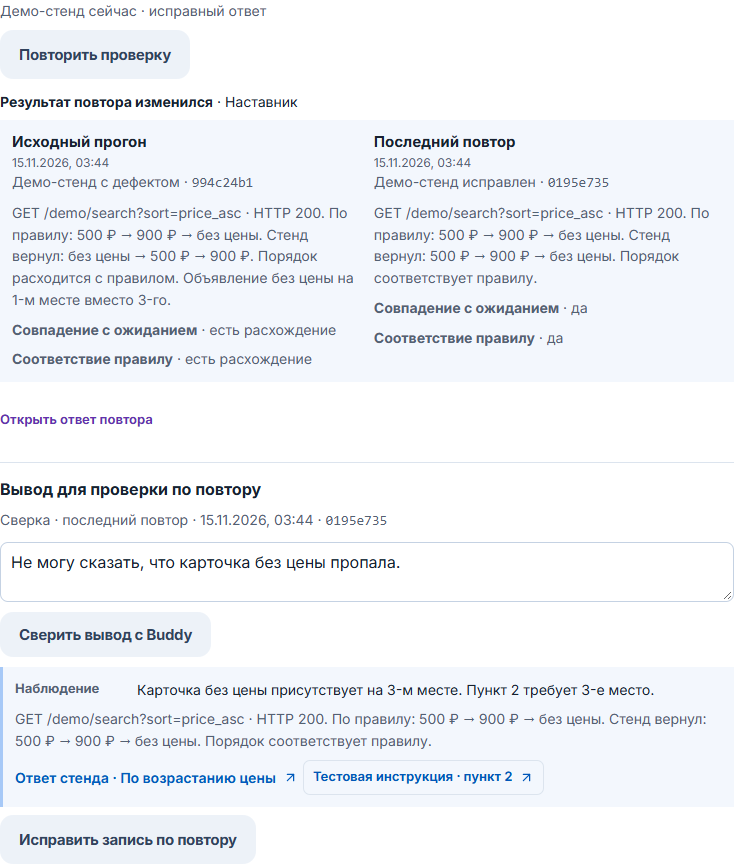
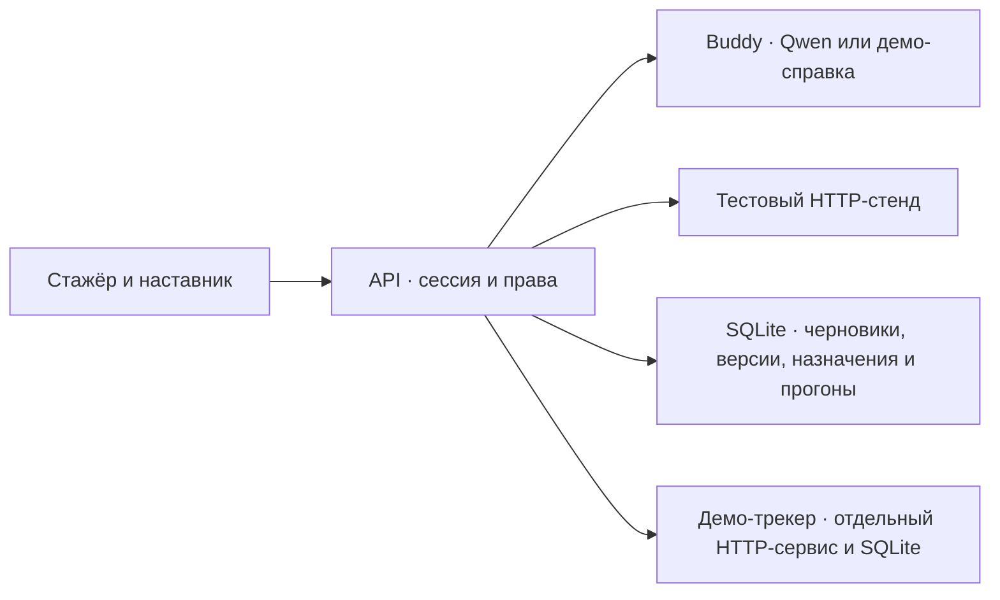

# AI-buddy · Первая проверка

**AI-наставник для первой рабочей проверки backend-стажёра.** Buddy помогает понять правило команды, выбрать запрос и сверить вывод с ответом стенда. Наставник получает запись, по которой может повторить проверку и дать обратную связь.

Прототип для кейса Авито на Hack&Change 2026. Наставник создаёт поручение, публикует его версию и назначает стажёру. Проверка связывает первый выбор, правило, HTTP-ответ и квитанцию в одной записи.

Комплект предыдущей итерации (`10af6b4`) сохранён отдельно. [Презентация той версии · PDF](docs/submission/AI-buddy-Hack-and-Change-2026.pdf) · [Видео той версии · MP4](docs/submission/AI-buddy-demo-2026.mp4)

[Запуск](#запуск) · [Поручение за пять минут](#поручение-за-пять-минут) · [Готовые сценарии](#проверка-за-пять-минут) · [Архитектура](#архитектура) · [Материалы для эксперта](#материалы-для-эксперта)



| Поручение | Что проверяет стажёр |
| --- | --- |
| **ARCHIVE-01 · Архивные товары** | Наставник назначает поручение. Стажёр сохраняет первый выбор до запуска. В записи видны финальное ожидание и момент обращения за подсказкой. |
| **ACTIVE-01 · Фильтр активных** | Наставник выбирает поручение из каталога. Общая выдача корректна, но `status=active` пропускает архивный товар. Стажёр выбирает диагностический запрос и передаёт вывод на ревью. |
| **SORT-01 · Сортировка по цене** | Два ответа с HTTP 200 могут соответствовать разным результатам. Стажёр сверяет фактический порядок и повторяет запрос после починки стенда. |
| **SEARCH-01 · Фильтр по городу** | Стажёр уточняет, был ли установлен фильтр, и проверяет, почему отсутствие Самары в одном запросе ожидаемо, а в другом означает дефект. |

## Запуск

Нужны Node.js 24.14 или новее из ветки 24 и pnpm 11.25.0. Версии зависимостей зафиксированы в lockfile.

```sh
pnpm install --frozen-lockfile
pnpm build
pnpm start
```

Открой [приложение на 127.0.0.1:3001](http://127.0.0.1:3001/). `pnpm start` запускает приложение и отдельную имитацию трекера на `127.0.0.1:3002`. Для первого прохода ключи, Ollama и учётные данные не нужны. Роли **Стажёр А**, **Стажёр Б** и **Наставник** выбираются в меню **Демо-вход**. Для разработки останови собранное приложение и выполни `pnpm dev`. Интерфейс откроется на [порту 5173](http://127.0.0.1:5173/), API использует порт 3001.

## Поручение за пять минут

1. После `pnpm start` открой рабочее пространство, выбери **Наставник** в **Демо-входе** и нажми **Создать поручение**. Назови его «Проверь индекс для ночной выгрузки». В описании укажи, что партнёр получает активные товары после переиндексации. Критерий — каждый активный товар встречается в ответе один раз.
2. Выбери проверку **Активные товары после переиндексации**. Предпросмотр покажет состав выдачи и требование уникальных ID. Нажми **Сохранить черновик**, **Опубликовать версию** и **Назначить версию 1.0**. Получатель — стажёр А.
3. Войди как **Стажёр А**. Нажми **Начать проверку**, выбери запрос к индексу, ожидаемые группы **Активные** и **Все ID уникальны**. Нажми **Зафиксировать первый вариант**. Спроси Buddy «Каким запросом проверить повторяющиеся ID?» и открой пункт правила в ответе.
4. Нажми **Запустить проверку**. HTTP 200 и группа «Активные» совпадают с ожиданием по составу. Сервер находит повтор `sku-401`. Введи «В ответе повторяется ID sku-401» и нажми **Сверить вывод с Buddy**. Подтверди публикацию. В записи рядом с выводом появятся «На ревью» и квитанция `TRK-…`.
5. Войди как **Наставник**. Открой сохранённое правило и исходный ответ. В **Демо-стенде** включи исправный ответ и нажми **Повторить проверку**. В исходном ответе ID повторялся, в повторе оба ID уникальны. Прими результат или верни запись с комментарием.

Через **Править в новом черновике** можно выпустить v2 и назначить её отдельно. Открытая v1 сохраняет прежнее правило. Под ролью **Стажёр Б** ссылки на это поручение и его запись возвращают 404.

## Проверка за пять минут

В чистой копии команда `pnpm dev` запускает демо-справку без ключей. Исходная роль — **Стажёр А**. При каждом запуске синтетический стенд начинает со сценария с дефектом. Открой [SORT-01 в режиме разработки](http://127.0.0.1:5173/?task=SORT-01) или [SORT-01 после сборки](http://127.0.0.1:3001/?task=SORT-01).

1. Нажми **Подготовить проверку**, своими словами предложи исключить карточку без цены, затем выбери **Использовать черновик**. Пункт 2 требует оставить карточку последней. Запусти проверку. При HTTP 200 карточка окажется первой.
2. Сверь вывод «500 и 900 идут по возрастанию, поэтому сортировка правильная». Buddy подтвердит порядок чисел и опровергнет итоговый тезис. Опубликуй наблюдение «Карточка без цены первая». Открой запись и найди квитанцию `TRK-…` под ID `QA-…`. Если трекер не подтвердил получение, стажёр может повторить отправку из записи.
3. В **Демо-входе** выбери **Наставник**, раскрой **Демо-стенд**, включи исправный ответ и нажми **Повторить проверку**. Сравни два ответа и верни запись с комментарием «Опиши результат после исправления». Как **Стажёр А** выбери **Сверить старый вывод с повтором**. Тот же вывод теперь опровергается. Ссылка **Ответ стенда** открывает ответ повтора. **Копировать доказательство** берёт опубликованный снимок и ссылку на его версию. Если нужно опубликовать новый вывод по повтору, нажми **Исправить запись по повтору**.
4. Как **Наставник** в записи SORT-01 открой **Демо-стенд**, нажми **Вернуть дефект на стенд**, затем перейди **К записям на ревью**. В каталоге назначь стажёру А **ACTIVE-01**. Как **Стажёр Б** попробуй открыть `/?task=ACTIVE-01`. Как **Стажёр А** открой **Фильтр активных**, выбери запрос без фильтра и зафиксируй ожидания. Спроси «Достаточно проверить общую выдачу?» и примени черновик. После запуска увидишь архивный товар в ответе с `status=active` при `HTTP 200`. Опубликуй этот вывод и проверь квитанцию `TRK-…`. Как наставник сравни первый и подтверждённый варианты в разделе **Ход попытки**, затем включи исправный стенд и повтори проверку.

Для ARCHIVE-01 диагностический запрос меняется. Выдача без фильтра теряет архивный товар, а `status=active` работает правильно. Оба поручения можно назначить независимо.

Для SEARCH-01 введи «Пришла Казань, думаю, этого достаточно». Ответь «Без фильтра» или «С фильтром по Казани» и сравни предлагаемые запросы. На дефектном стенде без фильтра пропадает Самара.

На телефоне чат разворачивается кнопкой **Спросить**. Через **Мои записи** стажёр может вернуться к своим опубликованным проверкам. Наставнику назначен стажёр А. Стажёр Б видит собственные прогоны и публикации.

## Режимы Buddy

| Режим | Что доступно |
| --- | --- |
| Buddy | Qwen через локальную Ollama или совместимый HTTPS-провайдер. При сбое приложение отмечает переход к демо-справке. |
| Демо-справка | Локальные подсказки по готовым и созданным поручениям, черновик и сверка с фактами. |
| Без Buddy | Инструкция, ручное ожидание, стенд, сравнение, вывод и публикация. Можно скопировать вопрос наставнику. |

При старте без конфигурации модели доступны демо-справка и ручной режим. Чтобы включить локальную Qwen, установи Ollama, выполни команду и заполни параметры в `.env` по примеру.

```sh
ollama pull qwen3:4b-instruct-2507-q4_K_M
```

```dotenv
BUDDY_BASE_URL=http://127.0.0.1:11434/v1
BUDDY_MODEL=qwen3:4b-instruct-2507-q4_K_M
BUDDY_TIMEOUT_MS=45000
```

Для удалённого совместимого провайдера укажи HTTPS-адрес и `BUDDY_API_KEY`. Сервер добавляет `/chat/completions` к базовому адресу и использует структурированный ответ JSON. [Протокол Ollama](https://docs.ollama.com/api/openai-compatibility) · [Модель Qwen](https://ollama.com/library/qwen3:4b-instruct-2507-q4_K_M)

## Архитектура



Buddy интерпретирует вопрос и предлагает черновик. Сервер проверяет доступ, разрешённые запросы и результат по сохранённому ответу. Стажёр подтверждает запуск и публикацию. Приложение сохраняет снимок и отправляет его метаданные в демо-трекер. Повтор с тем же ID публикации возвращает прежнюю квитанцию. Демо-стенд, инструкции и трекер используют синтетические данные. Подключение к корпоративным системам описано в [SDD](docs/first-check.sdd.md).

## Данные и проверка

React, TypeScript, Vite, Express и SQLite из Node.js. Локальный шрифт Inter распространяется по SIL Open Font License. Данные приложения хранятся в `.data/buddy.sqlite`, квитанции трекера — в `.data/tracker.sqlite`. Для отдельного прогона можно задать `BUDDY_DB_PATH` и `TRACKER_DB_PATH`. Схема обновляется при старте с сохранением старых ссылок. Оба сервиса слушают loopback.

```sh
pnpm typecheck
pnpm lint
pnpm test
pnpm coverage
pnpm build
pnpm eval:hardening --transfer --guide-only
```

Команда `pnpm eval:hardening --transfer` проверяет режим с настроенной моделью. Актуальное число тестов и покрытие выводит `pnpm coverage`. HTML-отчёт создаётся в `coverage/index.html`.

## Материалы для эксперта

| Требование | Где проверить |
| --- | --- |
| Командные правила, контракты и переходы | [SDD](docs/first-check.sdd.md) |
| Свободный ввод, уточнения и качество модели | [Независимый набор](scripts/eval-hardening.ts) и [регрессии](tests/feedback.test.ts) |
| Права, SQLite, стойкость к инъекциям и повтор запроса | [Тесты API](tests/api.test.ts) и [модельный контракт](tests/planning.test.ts) |
| Отправка в демо-трекер, отказ по полномочиям и повтор после потери ответа | [Контракт доставки](docs/first-check.sdd.md#http-адаптер-трекера) · [тесты HTTP](tests/api.test.ts) |
| Редактор, неизменяемые версии, проверка дублей и квитанция | [Приёмка редактора](docs/verification/first-check-authoring.md) · [приёмка предыдущего ZIP](docs/verification/first-check-submission.md) |
| Снимки результатов | [ARCHIVE-01](docs/screenshots/archive-transfer.png) · [SORT-01](docs/screenshots/first-check-evidence.png) · [SEARCH-01](docs/screenshots/search-01.png) |
| Тестовые конфигурации и данные | [Пример переменных окружения](.env.example) · [HTTP-стенд](server/app.ts) · [Каталог готовых поручений](server/archive-scenario.ts) · [Проверки редактора](server/task-catalog.ts) |
| Покрытие и оценка модели | [Сводка V8](docs/verification/transfer-coverage.json) · [Поимённые результаты](docs/verification/transfer-evaluation.jsonl) |
