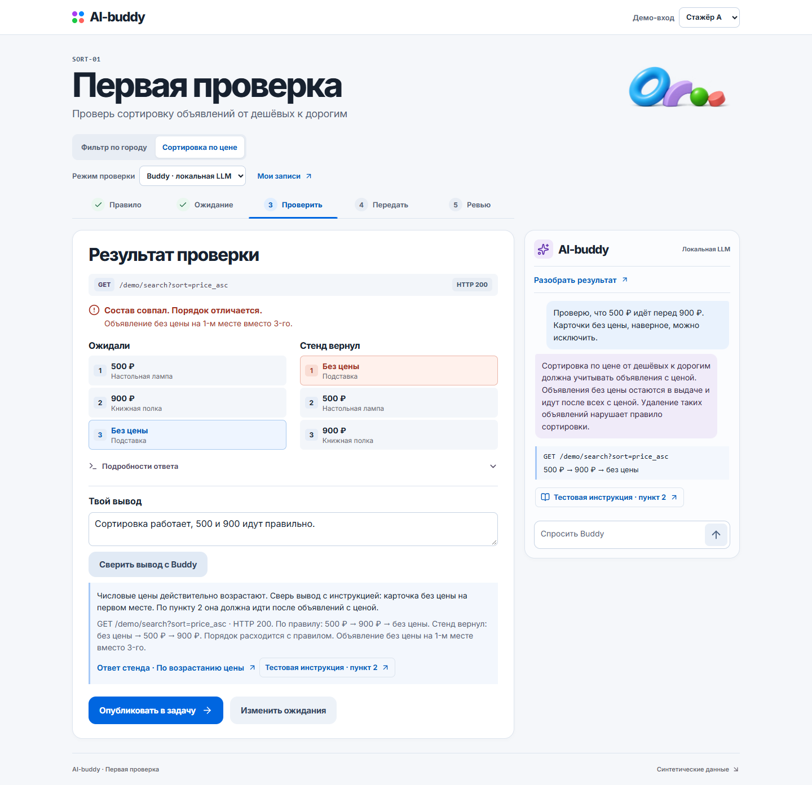

# AI-buddy · Первая проверка

Локальный прототип для кейса Авито на Hack&Change 2026. Backend-стажёр проверяет API поиска по инструкции команды, фиксирует наблюдение и передаёт воспроизводимую запись наставнику. Buddy помогает спланировать проверку и сверить вывод с ответом стенда.



## Запуск

Нужны Node.js 24.14 или новее из ветки 24 и pnpm 11.25.0. Версии зависимостей зафиксированы в lockfile.

```sh
pnpm install --frozen-lockfile
pnpm dev
```

Открой [рабочее пространство на порту 5173](http://127.0.0.1:5173/). Express обслуживает API на порту 3001. Для запуска собранной версии останови сервер разработки и выполни `pnpm build`, затем `pnpm start`. [Собранное приложение на порту 3001](http://127.0.0.1:3001/)

## Живая демонстрация

1. Открой **Сортировка по цене** → **Подготовить проверку**. Напиши в Buddy «Проверю, что 500 ₽ идёт перед 900 ₽. Карточки без цены, наверное, можно исключить».
2. Открой пункт 2 по ссылке Buddy. Нажми **Использовать черновик**. Форма заполнится порядком **500 ₽ → 900 ₽ → без цены**. Проверь ожидание, при желании измени его и отдельно нажми **Запустить проверку**.
3. Сравни колонки. Стенд отвечает HTTP 200, но карточка без цены стоит первой вместо третьей. В поле **Твой вывод** напиши «Сортировка работает, 500 и 900 идут правильно». Нажми **Сверить вывод с Buddy** и дополни вывод конкретным расхождением.
4. Нажми **Опубликовать в задачу**, проверь предпросмотр и подтверди. Открой ссылку на запись. В **Демо-входе** выбери **Наставник** и прими результат с комментарием. Переключись обратно на **Стажёр А**, чтобы увидеть решение на той же странице. Там же можно повторить запрос и сравнить два прогона.
5. Для **Фильтра по городу** начни подготовку с фразы «Пришла Казань, думаю, этого достаточно». На уточнение ответь «Нет, без фильтра». Применённый черновик заполняет ожидания для основного и контрольного запросов. Без фильтра пропала Самара, с `city=kazan` пришла Казань. Если в уточнении был фильтр по Казани, Buddy выделит контрольный запрос.

На телефоне чат разворачивается кнопкой **Спросить**. Через **Мои записи** стажёр может вернуться к своим опубликованным проверкам. Наставнику назначен стажёр А. Стажёр Б видит собственные прогоны и публикации.

## Режимы Buddy

| Режим | Что доступно |
| --- | --- |
| Buddy | Qwen через локальную Ollama или совместимый HTTPS-провайдер. При сбое приложение отмечает переход к демо-справке. |
| Демо-справка | Локальные подсказки по двум задачам, черновик и сверка с фактами. |
| Без Buddy | Инструкция, ручное ожидание, стенд, сравнение, вывод и публикация. Можно скопировать вопрос наставнику. |

При старте без конфигурации модели доступны демо-справка и ручной режим. Чтобы включить локальную Qwen, установи Ollama, выполни команду и заполни параметры в `.env` по примеру.

```sh
ollama pull qwen3:4b-instruct-2507-q4_K_M
```

```dotenv
BUDDY_BASE_URL=http://127.0.0.1:11434/v1
BUDDY_MODEL=qwen3:4b-instruct-2507-q4_K_M
BUDDY_TIMEOUT_MS=45000
```

Для удалённого совместимого провайдера укажи HTTPS-адрес и `BUDDY_API_KEY`. Сервер добавляет `/chat/completions` к базовому адресу и использует структурированный ответ JSON. [Протокол Ollama](https://docs.ollama.com/api/openai-compatibility) · [Модель Qwen](https://ollama.com/library/qwen3:4b-instruct-2507-q4_K_M)

## Данные и проверка

React, TypeScript, Vite, Express и SQLite из Node.js. Локальный шрифт Inter распространяется по SIL Open Font License. SQLite хранит демо-сессии, прогоны, записи и решения в `.data/buddy.sqlite`. Переменная `BUDDY_DB_PATH` позволяет запустить отдельную тестовую базу. Схема обновляется при старте с сохранением старых ссылок.

```sh
pnpm typecheck
pnpm lint
pnpm test
pnpm coverage
pnpm build
pnpm eval:buddy --workflow
pnpm eval:buddy --workflow --guide
pnpm eval:buddy --workflow --manual
```

| Требование | Где проверить |
| --- | --- |
| Командные правила, контракты и переходы | [SDD](docs/first-check.sdd.md) |
| Свободный ввод, уточнения и качество модели | [Оценочные случаи](tests/buddy-workflow-cases.ts) |
| Права, SQLite, стойкость к инъекциям и повтор запроса | [Тесты API](tests/api.test.ts) и [модельный контракт](tests/planning.test.ts) |
| Сквозные маршруты и замеры | [Отчёт о проверке](docs/verification/first-check.md) |
