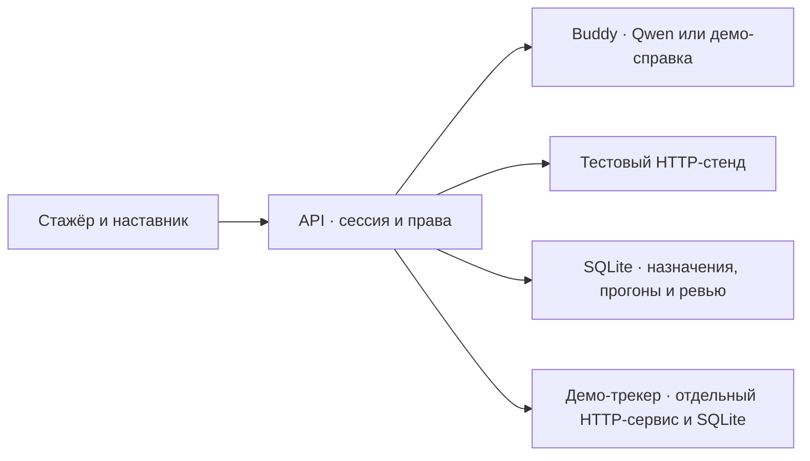

# AI-buddy · Первая проверка

**AI-наставник для первой рабочей проверки backend-стажёра.** Buddy помогает понять правило команды, выбрать запрос и сверить вывод с ответом стенда. Наставник получает запись, по которой может повторить проверку и дать обратную связь.

Прототип для кейса Авито на Hack&Change 2026. Эксперт получает ZIP с исходным кодом, этим README и материалами. Для локального запуска достаточно распаковать архив.

[Презентация · PDF](docs/submission/AI-buddy-Hack-and-Change-2026.pdf) · [Запись демонстрации · MP4](docs/submission/AI-buddy-demo-2026.mp4)

[Запуск](#запуск) · [Проверка за пять минут](#проверка-за-пять-минут) · [Архитектура](#архитектура) · [Материалы для эксперта](#материалы-для-эксперта)


| Поручение | Что проверяет стажёр |
| --- | --- |
| **ARCHIVE-01 · Архивные товары** | Наставник назначает проверку общей выдачи. При дефекте запрос без фильтра теряет архивные товары. |
| **ACTIVE-01 · Фильтр активных** | Наставник назначает проверку фильтра. При дефекте `status=active` пропускает архивные товары, а общая выдача проходит контроль. |
| **SORT-01 · Сортировка по цене** | Два ответа с HTTP 200 могут соответствовать разным результатам. Стажёр сверяет фактический порядок и повторяет запрос после починки стенда. |
| **SEARCH-01 · Фильтр по городу** | Стажёр уточняет, был ли установлен фильтр, и проверяет, почему отсутствие Самары в одном запросе ожидаемо, а в другом означает дефект. |

## Запуск

Нужны Node.js 24.14 или новее из ветки 24 и pnpm 11.25.0. Версии зависимостей зафиксированы в lockfile.

```sh
pnpm install --frozen-lockfile
pnpm build
pnpm start
```

Открой [приложение на 127.0.0.1:3001](http://127.0.0.1:3001/). `pnpm start` запускает приложение и отдельную имитацию трекера на `127.0.0.1:3002`. Для первого прохода ключи, Ollama и учётные данные не нужны. Роли **Стажёр А**, **Стажёр Б** и **Наставник** выбираются в меню **Демо-вход**. Для разработки останови собранное приложение и выполни `pnpm dev`. Интерфейс откроется на [порту 5173](http://127.0.0.1:5173/), API использует порт 3001.

## Проверка за пять минут

После `pnpm start` открой [SORT-01](http://127.0.0.1:3001/?task=SORT-01). Исходная роль — **Стажёр А**. Синтетический стенд начинает с дефекта.

1. Нажми **Подготовить проверку**, своими словами предложи исключить карточку без цены, затем выбери **Использовать черновик**. Пункт 2 требует оставить карточку последней. Запусти проверку. При HTTP 200 карточка окажется первой.
2. Сверь вывод «500 и 900 идут по возрастанию, поэтому сортировка правильная». Buddy подтвердит порядок чисел и опровергнет итоговый тезис. Опубликуй наблюдение «Карточка без цены первая». Открой запись и найди квитанцию `TRK-…` рядом с выводом. Если трекер ещё не подтвердил получение, нажми **Повторить отправку**.
3. В **Демо-входе** выбери **Наставник**. Кнопки **Открыть правило** и **Открыть исходный ответ** показывают источники. Раскрой **Демо-стенд**, включи исправный ответ и нажми **Повторить проверку**. Сравни два ответа и верни запись с комментарием «Опиши результат после исправления». Как **Стажёр А** выбери **Сверить старый вывод с повтором**. Тот же вывод теперь опровергается. Ссылка **Ответ стенда** открывает ответ повтора. **Копировать доказательство** берёт опубликованный снимок и ссылку на его версию. Если нужно опубликовать новый вывод по повтору, нажми **Исправить запись по повтору**.
4. Как **Наставник** верни дефект на стенд и перейди **К записям на ревью**. В поле **Шаблон проверки** выбери **ACTIVE-01** или **ARCHIVE-01** и нажми **Назначить стажёру А**. Как **Стажёр А** открой поручение, прочти правило, выбери запрос и сохрани ожидания кнопкой **Зафиксировать первый вариант**. Затем запусти проверку и опубликуй вывод. Наставник увидит первый и подтверждённый варианты. Под ролью **Стажёр Б** прямая ссылка на назначение или его запись вернёт отказ.

Для SEARCH-01 введи «Пришла Казань, думаю, этого достаточно». Ответь «Без фильтра» или «С фильтром по Казани» и сравни предлагаемые запросы. На дефектном стенде без фильтра пропадает Самара.

На телефоне чат разворачивается кнопкой **Спросить**. Через **Мои записи** стажёр может вернуться к своим опубликованным проверкам. Наставнику назначен стажёр А. Стажёр Б видит собственные прогоны и публикации.

## Режимы Buddy

| Режим | Что доступно |
| --- | --- |
| Buddy | Qwen через локальную Ollama или совместимый HTTPS-провайдер. При сбое приложение отмечает переход к демо-справке. |
| Демо-справка | Локальные подсказки по четырём задачам, черновик и сверка с фактами. |
| Без Buddy | Инструкция, ручное ожидание, стенд, сравнение, вывод и публикация. Можно скопировать вопрос наставнику. |

При старте без конфигурации модели доступны демо-справка и ручной режим. Чтобы включить локальную Qwen, установи Ollama, выполни команду и заполни параметры в `.env` по примеру.

```sh
ollama pull qwen3:4b-instruct-2507-q4_K_M
```

```dotenv
BUDDY_BASE_URL=http://127.0.0.1:11434/v1
BUDDY_MODEL=qwen3:4b-instruct-2507-q4_K_M
BUDDY_TIMEOUT_MS=45000
```

Для удалённого совместимого провайдера укажи HTTPS-адрес и `BUDDY_API_KEY`. Сервер добавляет `/chat/completions` к базовому адресу и использует структурированный ответ JSON. [Протокол Ollama](https://docs.ollama.com/api/openai-compatibility) · [Модель Qwen](https://ollama.com/library/qwen3:4b-instruct-2507-q4_K_M)

## Архитектура



Buddy интерпретирует вопрос и предлагает черновик. Сервер проверяет доступ, разрешённые запросы и результат по сохранённому ответу. Стажёр подтверждает запуск и публикацию. Приложение сохраняет снимок и отправляет его метаданные в демо-трекер. Повтор с тем же ID публикации возвращает прежнюю квитанцию. Демо-стенд, инструкции и трекер используют синтетические данные. Подключение к корпоративным системам описано в [SDD](docs/first-check.sdd.md).

## Данные и проверка

React, TypeScript, Vite, Express и SQLite из Node.js. Локальный шрифт Inter распространяется по SIL Open Font License. Данные приложения хранятся в `.data/buddy.sqlite`, квитанции трекера — в `.data/tracker.sqlite`. Для отдельного прогона можно задать `BUDDY_DB_PATH` и `TRACKER_DB_PATH`. Схема обновляется при старте с сохранением старых ссылок. Оба сервиса слушают loopback.

```sh
pnpm typecheck
pnpm lint
pnpm test
pnpm coverage
pnpm build
pnpm eval:hardening --transfer --guide-only
```

Команда `pnpm eval:hardening --transfer` проверяет режим с настроенной моделью. В сборке с отдельным демо-трекером на Windows 11 с Node.js 24.22.1 и pnpm 11.25.0 прошли **103 теста**, покрытие строк — **84,21% (1302 из 1546)**. HTML-отчёт создаётся в `coverage/index.html`.

## Материалы для эксперта

| Требование | Где проверить |
| --- | --- |
| Командные правила, контракты и переходы | [SDD](docs/first-check.sdd.md) |
| Свободный ввод, уточнения и качество модели | [Независимый набор](scripts/eval-hardening.ts) и [регрессии](tests/feedback.test.ts) |
| Права, SQLite, стойкость к инъекциям и повтор запроса | [Тесты API](tests/api.test.ts) и [модельный контракт](tests/planning.test.ts) |
| Отправка в демо-трекер, отказ по полномочиям и повтор после потери ответа | [Контракт доставки](docs/first-check.sdd.md#http-адаптер-трекера) · [тесты HTTP](tests/api.test.ts) |
| Назначение, права, квитанция, повтор после обрыва, проверка ZIP | [Приёмка комплекта](docs/verification/first-check-submission.md) · [протокол проверки с участниками](docs/verification/first-check-transfer.md#проверка-с-участниками) |
| Снимки результатов | [ARCHIVE-01](docs/screenshots/archive-transfer.png) · [SORT-01](docs/screenshots/first-check-evidence.png) · [SEARCH-01](docs/screenshots/search-01.png) |
| Тестовые конфигурации и данные | [Пример переменных окружения](.env.example) · [HTTP-стенд](server/app.ts) · [Каталог поручений](server/archive-scenario.ts) |
| Покрытие и оценка модели | [Покрытие комплекта](docs/verification/submission-coverage.json) · [Предыдущий прогон сравнения Qwen и справки](docs/verification/transfer-evaluation.jsonl) |
