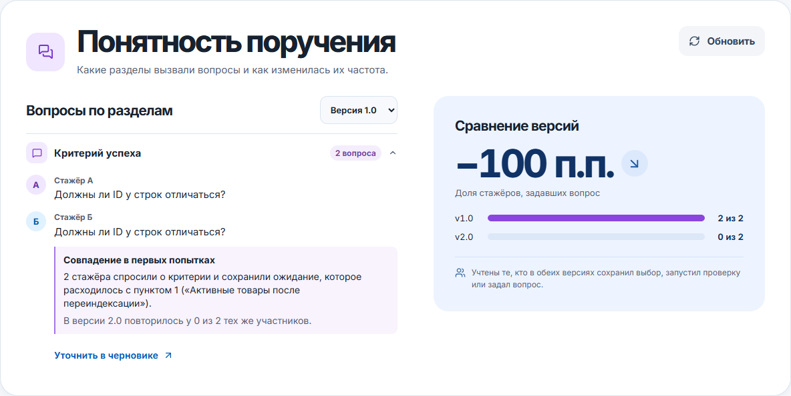
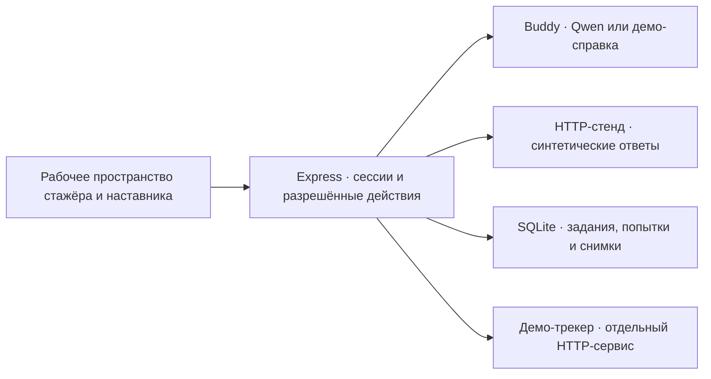

# AI-buddy · Первая проверка

**Помощник backend-стажёра от первого запроса до проверяемой записи на ревью.** Buddy помогает выбрать запрос по правилу команды и сверить вывод с фактическим HTTP-ответом. Наставник видит ход попытки, повторяет проверку и уточняет поручение по вопросам стажёров.

Прототип для кейса Авито на Hack&Change 2026.

[Запуск](#запуск) · [Демонстрация](docs/demo.md) · [Видео · MP4](docs/media/active-review.mp4) · [Архитектура](#архитектура) · [Материалы жюри](#материалы-жюри)



*Сравнение версий на синтетическом демо. В сводке учитываются одни и те же стажёры.*

## Что делает Buddy

- **До запуска** сравнивает первый выбор с правилом и предлагает диагностический запрос. Стажёр подтверждает запуск.
- **После ответа стенда** связывает вывод с конкретной строкой HTTP-ответа. В `ACTIVE-01` фильтр возвращает архивный товар при `HTTP 200`.
- **На ревью** показывает первый и итоговый выбор, обе подсказки, вывод до уточнения, исходный ответ и квитанцию отдельного демо-трекера.
- **В редакторе наставника** собирает вопросы по версии правила. Buddy предлагает уточнить формулировку по повторяющемуся затруднению, затем наставник сохраняет, публикует и назначает новую версию.

[Экран стажёра](docs/media/trainee-coaching.png) · [Разбор на ревью](docs/media/mentor-review.png)

## Запуск

Нужны **Node.js 24.14+ из ветки 24** и **pnpm 11.25.0**. Версии зависимостей фиксирует lockfile.

```sh
pnpm install --frozen-lockfile
pnpm build
pnpm start
```

Открой [127.0.0.1:3001](http://127.0.0.1:3001/). Роли **Стажёр А**, **Стажёр Б** и **Наставник** доступны в меню **Демо-вход**. Пароли и ключи для первого запуска не нужны. Приложение запускается вместе с отдельным демо-трекером на порту 3002.

Для быстрого прохода выбери **Наставник**, назначь `ACTIVE-01` стажёру А, переключись на **Стажёр А** и открой **Фильтр активных**. [Пошаговая проверка](docs/demo.md#первая-проверка-api)

Для ответов живой модели подключи локальную Qwen через Ollama или совместимый HTTPS-провайдер. При отключённой модели доступна демо-справка. [Настройка модели](docs/demo.md#подключение-модели) · [Пример конфигурации](.env.example)

## Архитектура



Сервер проверяет права, запросы и факты. Модель получает контекст задачи и допустимые источники. Снимок ответа, версия правила и квитанция сохраняются независимо от доступности модели. [Спецификация AI-сценариев и интеграций](docs/first-check.sdd.md)

| Где | Что находится |
| --- | --- |
| [`src/`](src) | Интерфейс, рабочее пространство, редактор поручений и ревью |
| [`server/`](server) и [`shared/`](shared) | HTTP-контракты, Buddy, SQLite, стенд и трекер |
| [`tests/`](tests) и [`scripts/`](scripts) | Автоматические тесты и воспроизводимые сценарии оценки модели |
| [`docs/`](docs) | Демо, SDD, результаты проверок и медиа |

## Проверка

Тесты, проверка типов, линтер и сборка воспроизводятся из чистой копии.

```sh
pnpm typecheck
pnpm lint
pnpm coverage
pnpm build
```

**112 тестов · 82,00% покрытия строк (1 764 из 2 151).** Режим с живой Qwen и работа без ключей проверены отдельно. [Отчёт приёмки](docs/verification/README.md) · [Сводка V8](docs/verification/coverage.json)

## Материалы жюри

| Что проверить | Где открыть |
| --- | --- |
| Прототип, роли и тестовые сценарии | [Запуск](#запуск) · [Инструкция проверки](docs/demo.md) |
| Путь от первого выбора до результата и ревью | [Видео текущей сборки · MP4](docs/media/active-review.mp4) |
| Источники Buddy, права и интеграции | [SDD](docs/first-check.sdd.md) · [Приёмка и доказательства](docs/verification/README.md) |
| Тесты, покрытие и способ измерения пользы | [Тесты](tests) · [Покрытие](docs/verification/coverage.json) · [Протокол пилота](docs/verification/README.md#как-измерить-пользу) |
| Продуктовая презентация предыдущей итерации | [PDF в истории проекта](https://github.com/Dteaher/avito-ai-buddy/blob/10af6b4f71df8786fe7edb17e2ad230457f549cb/docs/submission/AI-buddy-Hack-and-Change-2026.pdf) |

Инструкции, аккаунты и данные стенда синтетические. Эффект на реальных стажёрах предстоит измерить в пилоте.
