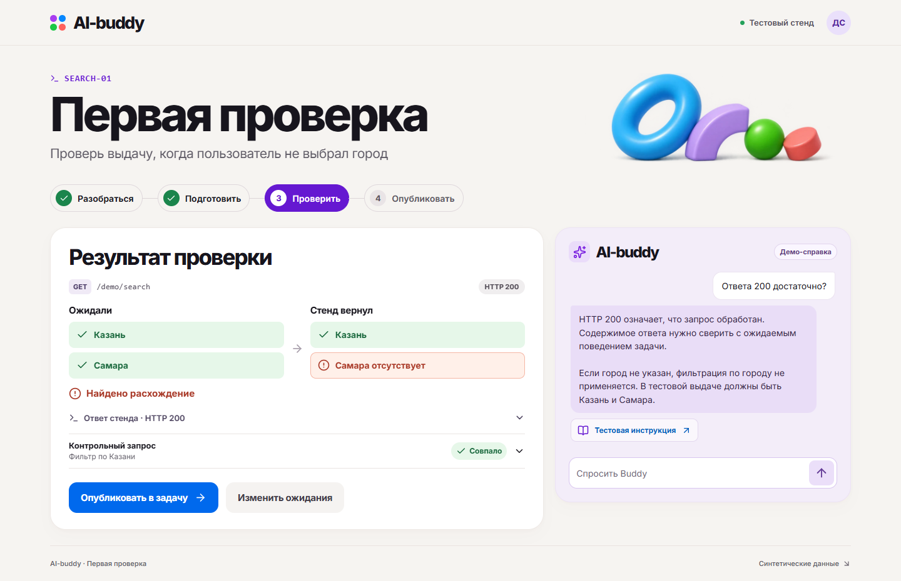
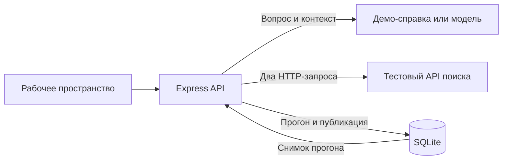

# AI-buddy · Первая проверка

Локальный MVP для кейса Авито на Hack&Change 2026. Backend-стажёр получает задачу SEARCH-01, уточняет у Buddy правила команды поиска, проверяет API и сохраняет результат в тестовом трекере. В сценарии HTTP 200 приходит вместе с дефектом выдачи, поэтому стажёр сверяет содержимое ответа с ожиданием.



## Запуск

Понадобятся Node.js 24.14 или новее из ветки 24 и pnpm 11.25.0. Сборка проверена с Node.js 24.22.1. Если pnpm ещё не установлен, выполни `npm install --global pnpm@11.25.0`.

Выполни команды из корня репозитория.

```sh
pnpm install --frozen-lockfile
pnpm dev
```

Открой [http://127.0.0.1:5173](http://127.0.0.1:5173/). Vite запускает интерфейс, Express слушает порт `3001`. Демо-сессия стажёра создаётся автоматически при открытии страницы. Ключи и учётные данные для этого режима не нужны.

Чтобы запустить собранную версию, останови `pnpm dev`, затем выполни `pnpm build` и `pnpm start`. Приложение и API будут доступны на [http://127.0.0.1:3001](http://127.0.0.1:3001/).

## Пройти SEARCH-01

1. Спроси Buddy «Ответа 200 достаточно?» и открой тестовую инструкцию команды поиска.
2. Нажми **Подготовить проверку**. Для `GET /demo/search` выбери Казань и Самару. Для `GET /demo/search?city=kazan` выбери Казань.
3. Нажми **Запустить проверку**. В основном запросе появятся «Найдено расхождение» и «Самара отсутствует». В контрольном запросе будет «Совпало». Раскрой ответы, чтобы посмотреть объявления и исходный JSON. Если в первом запросе выбрать только Казань, сравнение покажет совпадение с фактом и отдельную подсказку об ожидании по инструкции.
4. Нажми **Опубликовать в задачу**, проверь предпросмотр и подтверди. Открой ссылку `/records/QA-…` и обнови страницу. Запись с тем же ID и содержимым доступна после перезапуска приложения на том же адресе.

## Режимы Buddy

| Режим | Настройка | Проверка |
| --- | --- | --- |
| Демо-справка | Режим по умолчанию. Источник — тестовая инструкция в `server/scenario.ts`. | Проверен в Chrome и тестах. |
| Режим модели | Скопируй `.env.example` в `.env`. Заполни `BUDDY_BASE_URL`, `BUDDY_MODEL` и `BUDDY_API_KEY`. Перезапусти приложение. | Формат запроса, контекст, ответ и сбой проверены с локальным HTTP-имитатором. Внешний провайдер в этой сборке не проверялся. |

`BUDDY_BASE_URL` — базовый адрес OpenAI-совместимого сервиса, например `https://api.openai.com/v1`. Сервер добавляет `/chat/completions`. В `BUDDY_MODEL` укажи доступный на выбранном сервисе ID модели. Если хотя бы одно поле пустое, используется демо-справка. Ключ хранится в `.env` на сервере. В запрос к модели входят вопрос, задача и синтетическая инструкция. Запуск и публикация выполняются кнопками интерфейса через отдельные маршруты API.

## Данные и архитектура

React 19.3.1, TypeScript 5.9.3, Vite 8.3.7, Express 5.3.0 и SQLite из Node.js. Точные версии зависимостей зафиксированы в `package.json` и `pnpm-lock.yaml`. Шрифт Inter поставляется локально по SIL Open Font License. Стенд, команда, инструкция и трекер тестовые.



Сервер проверяет демо-сессию и назначение задачи, выбирает допустимые URL сам, а запись ищет по владельцу и задаче. SQLite хранит снимок каждого прогона и обеспечивает уникальность публикации по ID прогона. При интеграции с корпоративной системой демо-сессию и локальный трекер можно заменить корпоративной авторизацией и адаптером трекера, сохранив сценарий проверки.

Данные находятся в `.data/buddy.sqlite`. Для сброса останови приложение, удали этот файл и запусти приложение снова. Сохранённые ранее ссылки перестанут открываться. Рабочие данные и секреты исключены из Git.

## Проверки

```sh
pnpm typecheck
pnpm lint
pnpm test
pnpm coverage
pnpm build
```

Vitest 4.1.12 и V8 считают покрытие TypeScript-кода приложения в `src`, `server` и `shared`, включая точки входа. `pnpm coverage` создаёт HTML-отчёт `coverage/index.html` и сводку `coverage/coverage-summary.json`. Порог покрытия строк — 81%. Интеграционные тесты выполняют реальные HTTP-запросы к локальному стенду и проверяют сохранение в SQLite после перезапуска.

На Windows с Node.js 24.22.1 прошли 15 тестов, покрытие строк составило 93,31% (293 из 314). Сценарий пройден в Chrome при 1440×900 и 390×844, включая открытие обоих сырых ответов и обновление страницы опубликованной записи.

| Требование | Где проверить |
| --- | --- |
| Контекст Buddy, правила действий и приёмка | [SDD-спецификация](docs/first-check.sdd.md) |
| HTTP 200 с дефектом, контрольный запрос, права, повтор публикации | [Интеграционные тесты API](tests/api.test.ts) |
| Сквозной интерфейс, неверное ожидание и восстановление после ошибок | [Тесты интерфейса](tests/workflow.test.tsx) и шаги SEARCH-01 выше |
| Презентация и видео | Остались для финальной сдачи. |

Для оценки пользы на стажёрах можно сравнить прохождение задания по одной инструкции и с Buddy. Зафиксировать время до сохранённой записи, долю участников, которые обнаружили расхождение при HTTP 200, и число обращений к наставнику. Эти показатели пока не измерялись.
