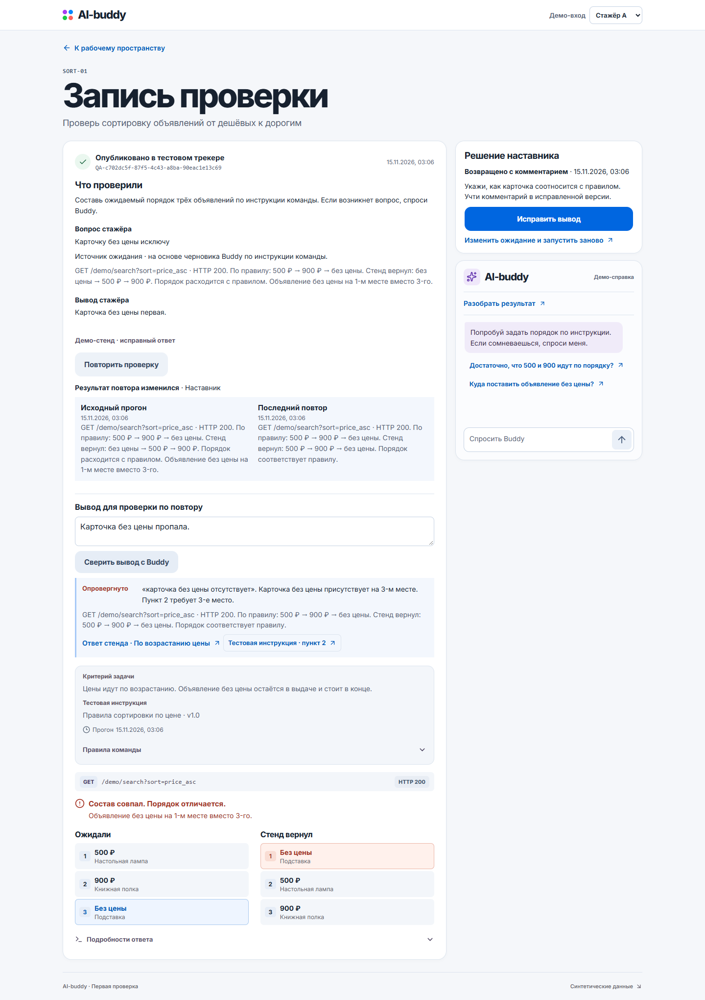

# AI-buddy · Первая проверка

Локальный прототип для кейса Авито на Hack&Change 2026. Backend-стажёр проверяет API поиска по инструкции команды, фиксирует наблюдение и передаёт воспроизводимую запись наставнику. Buddy помогает спланировать проверку и сверяет отдельные утверждения с ответом стенда. Наставник может запросить исправление или повторить запрос по опубликованной записи.



## Запуск

Нужны Node.js 24.14 или новее из ветки 24 и pnpm 11.25.0. Версии зависимостей зафиксированы в lockfile.

```sh
pnpm install --frozen-lockfile
pnpm dev
```

Открой [рабочее пространство на порту 5173](http://127.0.0.1:5173/). Express обслуживает API на порту 3001. Для запуска собранной версии останови сервер разработки и выполни `pnpm build`, затем `pnpm start`. [Собранное приложение на порту 3001](http://127.0.0.1:3001/)

## Живая демонстрация

1. На чистом запуске открой **Сортировка по цене** → **Подготовить проверку**. Напиши «Карточку без цены исключу». Открой пункт 2 и нажми **Использовать черновик**. В форму попадёт порядок **500 ₽ → 900 ₽ → без цены**.
2. Запусти проверку. При HTTP 200 карточка без цены окажется первой. Введи «500 и 900 идут по возрастанию, поэтому сортировка правильная» и сверь вывод с Buddy. Сравни статусы двух тезисов. Исправь текст на «Карточка без цены первая» и опубликуй запись.
3. В **Демо-входе** выбери **Наставник**, верни запись с комментарием «Укажи расхождение с правилом». Раскрой **Демо-стенд**, включи исправный ответ и нажми **Повторить проверку**. Сравни исходный и новый ответ.
4. Переключись на **Стажёр А**. Выбери **Сверить старый вывод с повтором**. Можно оставить исходный вывод о первом месте или ввести «Карточка без цены пропала». Buddy опровергнет тезис по третьей позиции. Затем через **Исправить вывод** отправь уточнение именно об исходном прогоне. Наставник увидит исправление и свой комментарий рядом.
5. Для **Фильтра по городу** введи «Пришла Казань, думаю, этого достаточно». Ответь «Без фильтра» или «С фильтром по Казани» и сравни предлагаемые запросы. Перед демонстрацией пропавшей Самары верни режим стенда с дефектом.

На телефоне чат разворачивается кнопкой **Спросить**. Через **Мои записи** стажёр может вернуться к своим опубликованным проверкам. Наставнику назначен стажёр А. Стажёр Б видит собственные прогоны и публикации.

## Режимы Buddy

| Режим | Что доступно |
| --- | --- |
| Buddy | Qwen через локальную Ollama или совместимый HTTPS-провайдер. При сбое приложение отмечает переход к демо-справке. |
| Демо-справка | Локальные подсказки по двум задачам, черновик и сверка с фактами. |
| Без Buddy | Инструкция, ручное ожидание, стенд, сравнение, вывод и публикация. Можно скопировать вопрос наставнику. |

При старте без конфигурации модели доступны демо-справка и ручной режим. Чтобы включить локальную Qwen, установи Ollama, выполни команду и заполни параметры в `.env` по примеру.

```sh
ollama pull qwen3:4b-instruct-2507-q4_K_M
```

```dotenv
BUDDY_BASE_URL=http://127.0.0.1:11434/v1
BUDDY_MODEL=qwen3:4b-instruct-2507-q4_K_M
BUDDY_TIMEOUT_MS=45000
```

Для удалённого совместимого провайдера укажи HTTPS-адрес и `BUDDY_API_KEY`. Сервер добавляет `/chat/completions` к базовому адресу и использует структурированный ответ JSON. [Протокол Ollama](https://docs.ollama.com/api/openai-compatibility) · [Модель Qwen](https://ollama.com/library/qwen3:4b-instruct-2507-q4_K_M)

## Данные и проверка

React, TypeScript, Vite, Express и SQLite из Node.js. Локальный шрифт Inter распространяется по SIL Open Font License. SQLite хранит демо-сессии, прогоны, записи и решения в `.data/buddy.sqlite`. Переменная `BUDDY_DB_PATH` позволяет запустить отдельную тестовую базу. Схема обновляется при старте с сохранением старых ссылок.

```sh
pnpm typecheck
pnpm lint
pnpm test
pnpm coverage
pnpm build
pnpm eval:hardening
pnpm eval:hardening --guide-only
pnpm eval:hardening --audit
```

| Требование | Где проверить |
| --- | --- |
| Командные правила, контракты и переходы | [SDD](docs/first-check.sdd.md) |
| Свободный ввод, уточнения и качество модели | [Независимый набор](scripts/eval-hardening.ts) и [регрессии](tests/feedback.test.ts) |
| Права, SQLite, стойкость к инъекциям и повтор запроса | [Тесты API](tests/api.test.ts) и [модельный контракт](tests/planning.test.ts) |
| Сквозные маршруты и замеры | [Актуальный отчёт](docs/verification/first-check-hardening.md) · [предыдущая итерация](docs/verification/first-check.md) |
