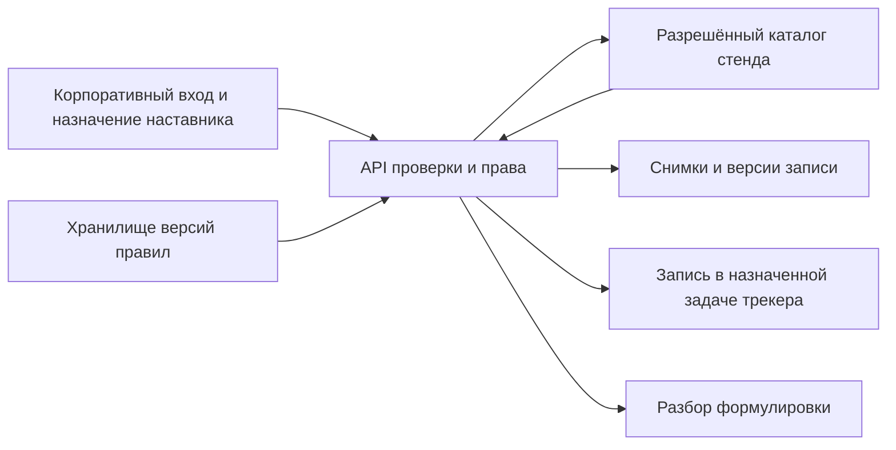

# Первая рабочая проверка

Стажёр команды поиска получает поручение на проверку API. Последовательность в рабочем пространстве строится по фактическим этапам: правило → ожидание → запрос → передача → ревью. Стажёр подтверждает запуск и публикацию. Наставник решает, пригодна ли запись для работы, в том числе если проверка зафиксировала дефект.

| Задача | Разрешённые запросы | Правило | Ответ на чистом запуске |
| --- | --- | --- | --- |
| SEARCH-01 | `GET /demo/search`, `GET /demo/search?city=kazan` | Без фильтра Казань и Самара. В контроле только Казань. | Оба запроса возвращают HTTP 200 и Казань. Без фильтра отсутствует Самара. |
| SORT-01 | `GET /demo/search?sort=price_asc` | 500 ₽ → 900 ₽ → без цены. | HTTP 200 и полный состав. Объявление без цены стоит первым. |

## Выбор ожидания и сверка вывода

- В подготовке свободный вопрос отправляется с `intent: 'plan'`. Buddy может дать черновик, задать один вопрос о недостающем параметре или сообщить, что источников недостаточно. При неоднозначном фильтре SEARCH-01 спрашивает, был ли `city=kazan`. После уточнения выделяет соответствующий запрос. Форма SEARCH-01 сохраняет исходную пару проверок и заполняет ожидания для обеих.
- В ответе модели для черновика есть `checkId`, `expected` и ID источников. Сервер сверяет задачу, состав и порядок с каталогом, проверяет источники и пропускает итоговую форму через те же валидаторы, что и ручной запуск. URL берётся из каталога. Выбор **Использовать черновик** наполняет форму. Ожидание после любых правок сохраняется при запуске. Исходная фраза записывается только при явном применении черновика и запуске.
- В результате `intent: 'review'` требует ID сохранённого прогона. Qwen выделяет тезисы по ограниченному списку с явным отрицанием. Сервер сохраняет явно распознанные формулировки, сверяет каждый тезис с нормализованным снимком и возвращает статус подтверждения, опровержения или уточнения с источниками. Состояние стенда и тезис стажёра оцениваются раздельно. Предполагаемые причины отделяются от наблюдений. Необработанный текст поиска, ID неизвестных объявлений и сырые тела ответов в контекст не передаются. При отсутствии прогона интерфейс предлагает сначала запустить проверку.
- Запрос к модели использует OpenAI-совместимый `response_format: json_schema`. Структурированный ответ может быть повторён один раз после ошибки валидации в пределах общего тайм-аута. При сбое или тайм-ауте ответ явно помечается как демо-справка. Доступны форма, пользовательский ввод и уже полученный результат. Закрытие запроса отменяет инференс. Смена задачи открывает отдельное рабочее пространство.
- Ответ Buddy содержит `kind` (`guidance`, `draft`, `clarification`, `feedback`, `insufficient` или `action`), `mode`, `text`, `sources` и опционально `draft`, `facts`, `verdicts`, `note`, `escalation`. Источники разрешаются в пункт инструкции либо запрос сохранённого прогона. Вопросы вне инструкции могут вернуть короткий шаблон эскалации. Копирование подтверждается локально. Фактическая отправка происходит в рабочем чате.
- `mode: 'guide'` отключает провайдер и использует подсказки. `mode: 'manual'` отключает диалог и предлагает инструкцию и переход к наставнику. Интерфейс в ручном режиме выполняет проверки и публикации через тот же API. Режим сохраняется во вкладке.

## Сессии и серверные контракты

Демо-вход рассчитан на локальную демонстрацию и доступен на loopback. `POST /api/session` выдаёт случайный токен в cookie `HttpOnly; SameSite=Strict`. Хранилище сессий в SQLite позволяет возвращаться после перезапуска. При смене роли предыдущая сессия этой вкладки отзывается. Стажёр А сохраняет идентификатор `demo-trainee` для доступа к старым данным. У стажёра Б отдельный идентификатор. Наставнику назначен стажёр А.

| Маршрут | Предусловия и поведение |
| --- | --- |
| `GET /api/workspace?task=SORT-01` | Возвращает роль, режим и инструкцию. Без действующей cookie открывает демо-сессию стажёра А. |
| `POST /api/tasks/:taskId/buddy` | Стажёр в доступной задаче. `question` до 500 символов, опционально `intent`, `mode`, `runId`, `clarificationId`, `conversationId`. Недоступный прогон возвращает 404. Уточнение живёт до 10 минут, диалог до 30 минут и 3 пар реплик. Контекст привязан к личности, задаче, режиму, а для сверки ещё и к прогону. |
| `POST /api/tasks/:taskId/runs` | Стажёр подтверждает `checks`. Для SEARCH-01 нужны обе проверки и допустимые уникальные города. Для SORT-01 нужен порядок трёх уникальных ID. Опциональный `preparation` сообщает о применении черновика и указывает существующий ID проверки. Сервер отправляет только разрешённые GET. |
| `GET /api/tasks/:taskId/runs/:runId` | Доступен владельцу прогона в его задаче. |
| `POST /api/tasks/:taskId/runs/:runId/publication` | Подтверждение владельца. Принимает `conclusion` до 1000 символов. Уникальность по ID прогона возвращает ту же запись при повторе. Изменённое ожидание требует нового запуска. |
| `GET /api/records`, `GET /api/records/:id` | Стажёр видит свои записи. Наставник видит только опубликованные записи назначенного стажёра. |
| `POST /api/records/:id/review` | Наставник назначенного стажёра оставляет `accepted` или `returned`. Для возврата нужен комментарий. Решение сохраняется один раз. Повторное решение возвращает 409. |
| `POST /api/records/:id/revisions` | Владелец возвращённой записи отправляет исправленный вывод с исходным прогоном или указывает новый собственный прогон той же задачи. Повтор идентичной правки возвращает ту же версию. На одну возвращённую версию разрешено одно исправление. |
| `POST /api/records/:id/replay` | Владелец или назначенный наставник повторяет опубликованный запрос. Сервер сверяет каталог и выполняет новый GET. Последний повтор показывает автора, дату и изменение нормализованного ответа рядом с оригиналом. |
| `POST /api/demo/stand` | Наставник выбирает состояние синтетического стенда в пределах локального процесса. Повторная установка того же состояния безопасна. При перезапуске стенд начинает с дефекта. Снимки хранят метку из фактического HTTP-ответа. |

Снимок прогона хранит версию инструкции, ожидание, HTTP-статус, ответ, нормализованные элементы и итог сравнения. Совпадение с ожиданием стажёра отдельно от проверки правила. Публикация хранит ссылку на исходный снимок и текст вывода. Решение наставника хранится в отдельной таблице. SQLite мигрирует прежние строки в версионируемую таблицу с теми же ID. Частичный уникальный индекс сохраняет одну каноническую публикацию на прогон. Исправление только вывода использует тот же снимок и отдельный ID версии. Версия с новым прогоном становится его канонической публикацией. Связь предыдущей и следующей версий и уникальное решение наставника исключают конкурирующие правки и повторные решения.

Ошибки ввода возвращают 400, отсутствие сессии 401, попытка ревью от стажёра 403, недоступный ресурс 404, конфликт решения или изменившийся каталог для повтора 409, сбой стенда 502. Ошибки прогона или публикации оставляют введённые ожидание или вывод в форме. Решение наставника не изменяет снимок и вычисленный вердикт.

## Приёмка и интеграция

- SORT-01 проходит от исправления предположения до принятого ревью, SEARCH-01 от уточнения фильтра до опубликованной записи и решения. Оба дефекта видны при HTTP 200.
- Проверяются запреты на чужой прогон и запись, отсутствие доступа наставника к неопубликованным данным, идемпотентность, совместимость SQLite, инъекции в данных, ручной режим, ограниченный тайм-аут и узкий экран.

## Границы интеграции

| Участок | В демо | При внедрении |
| --- | --- | --- |
| Идентичность и назначение | Cookie, два стажёра и назначение наставника в серверном каталоге | Корпоративный вход, выдача задачи и связь наставника с человеком из внутренней системы. Права проверяются по назначению при каждой операции. |
| Источник правила | Версия инструкции сохраняется в каждом снимке. Модель получает только разрешённые источники. | Версионированная база знаний с проверкой доступа. При отсутствии источника показать уточнение, ручную инструкцию или предметную эскалацию. |
| Стенд | Сервер выбирает путь из каталога. Повтор проверяет совместимость пути и ожидания. | Разрешённый origin и операции с минимальными полномочиями. Тайм-аут оставляет прошлый снимок доступным. |
| Трекер | Локальная публикация и история в SQLite. | Делегированная операция с правом записи в назначенную задачу. Ключ идемпотентности привязан к каноническому прогону либо к версии. Ошибка сохраняет ввод, повтор возвращает прежнюю ссылку. |
| MCP | Точка выполнения — HTTP API приложения. | MCP может стать транспортом с теми же проверками прав, идемпотентностью и явным подтверждением запуска и публикации. |

## Пилот для одной backend-команды

1. Тимлид назначает владельца пилота и отбирает два сопоставимых поручения. Сервис назначения отдаёт идентификаторы стажёра, задачи и наставника. Служба корпоративного доступа выдаёт сессию. Эти данные заменяют локальный демо-вход.
2. Владелец правила со стороны команды утверждает исходную инструкцию. Сервер читает её с проверкой доступа и хранит ID, версию и применённый текст рядом со снимком. При недоступной инструкции проверка по правилу требует восстановления доступа или эскалации наставнику.
3. Владелец стенда разрешает методы, маршруты и параметры в серверном каталоге. Сервер повторяет опубликованный запрос для владельца или назначенного наставника, пока запись и текущий каталог совместимы. При изменении каталога старый ответ сохраняется, а для новой попытки согласуется актуальный запрос.
4. Интеграция с трекером использует право создания записи в назначенной задаче. Для каждого исходного прогона и каждой исправленной версии формируется стабильный ключ. При тайм-ауте отправитель сначала запрашивает результат по ключу и затем повторяет операцию. В пилоте проверяются одновременные запросы и сбой после записи, но до получения ответа.
5. Модель получает формулировку и разрешённые данные. Сомнение и цитата ведут к наблюдению. Сомнительный или недоступный ответ оставляет проверку по снимку, справку и ручной путь. MCP можно подключить как транспорт поверх тех же разрешений и подтверждений.
6. До подключения стажёров ответственный за доступ проверяет контрольные роли и способы отзыва. Для замеров нужны две инструкции, два набора ответов, обезличенные записи, время и число фактических обращений к наставнику. Владелец пилота останавливает новые назначения при нарушении доступа или систематической неверной сверке. Ответственный за доступ отзывает права, наставник разбирает затронутые записи, а владелец повторяет приёмку перед возобновлением.

Технические результаты и методика сравнения со стажёрами доступны в [актуальном отчёте](verification/first-check-evidence.md).
