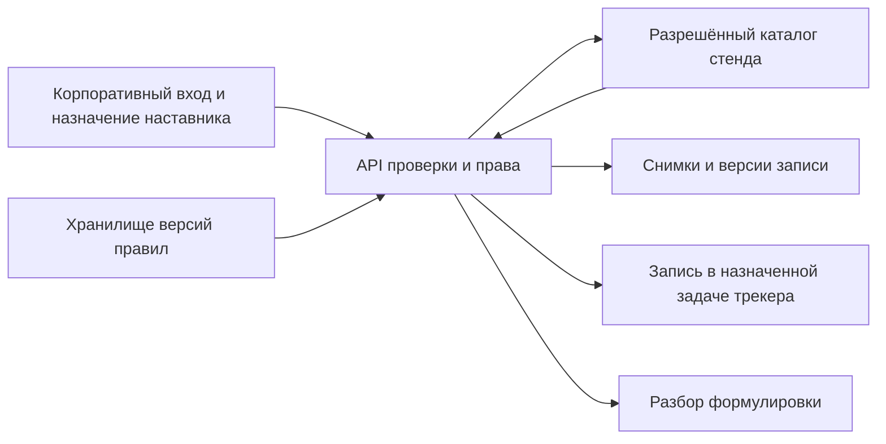

# Первая рабочая проверка

Стажёр команды поиска получает поручение на проверку API. Последовательность в рабочем пространстве строится по фактическим этапам: правило → ожидание → запрос → передача → ревью. Стажёр подтверждает запуск и публикацию. Наставник решает, пригодна ли запись для работы, в том числе если проверка зафиксировала дефект.

| Задача | Разрешённые запросы | Правило | Ответ на чистом запуске |
| --- | --- | --- | --- |
| SEARCH-01 | `GET /demo/search`, `GET /demo/search?city=kazan` | Без фильтра Казань и Самара. В контроле только Казань. | Оба запроса возвращают HTTP 200 и Казань. Без фильтра отсутствует Самара. |
| SORT-01 | `GET /demo/search?sort=price_asc` | Числовые цены не убывают. Карточки без цены идут последними. Исходный набор стоит 500 ₽ → 900 ₽ → без цены. | HTTP 200 и полный состав. Объявление без цены стоит первым. |
| ARCHIVE-01 | `GET /demo/inventory`, `GET /demo/inventory?status=active` | Без фильтра активные и архивные товары. В контроле только активные. | Оба запроса возвращают HTTP 200 и активный товар. Без фильтра отсутствует архивный. |
| ACTIVE-01 | `GET /demo/inventory/audit?status=active`, `GET /demo/inventory/audit` | С фильтром только активные товары. В контроле обе группы. | Оба запроса возвращают HTTP 200 и обе группы. Фильтр ошибочно пропускает архивный товар. |

Экран, Buddy и резюме записи SORT-01 используют [общий расчёт](../shared/run-summary.ts). Совпадение ожидания учитывает порядок ID и цены из сохранённого набора. Изменения цены, признака «без цены» и состава описываются отдельно. Правило проверяет неубывание фактических цен и положение всех карточек без цены. Равные цены допускают любой порядок. Потеря или добавление карточки означает изменение состава, а проверка последовательности выполняется по полученному набору. Если ожидаемая карточка отсутствует, её отсутствие явно видно в разборе снимка.

## Редактор поручений

Наставник задаёт название, описание и критерий успеха, выбирает одну или несколько проверок из серверного каталога и видит предпросмотр. Текст критерия объясняет цель стажёру. Машинная часть правила складывается из сохранённых проверок каталога. Сервер формирует пункты правила из точных параметров, необходимых групп и условий над ответом.

Первый пример проверяет выгрузку активных товаров после переиндексации. `GET /demo/inventory/reindex` на дефектном стенде возвращает HTTP 200 и `[sku-401, sku-402, sku-401]`. Группа «Активные» соответствует правилу. Условие уникальности ID нарушено. Исправный ответ содержит `[sku-401, sku-402]`. Для этой проверки стажёр задаёт ожидаемые группы и выбирает, ожидает ли повторы ID. Результат сравнения с ожиданием, результат по правилу и сырой HTTP-ответ показываются отдельно.

`authored_projects` хранит рабочий черновик наставника. Поля можно заполнить частично и вернуться позже. Токен ревизии защищает от публикации или перезаписи устаревшего черновика. `authored_versions` хранит опубликованный снимок и исходное содержание. Повтор публикации с уже использованным токеном возвращает тот же снимок. Версия получает отдельный ключ `TASK-<uuid>-v<N>`. Правка сохраняет новый черновик. Назначение новой версии требует явного действия. Существующие назначения, попытки и записи продолжают использовать свой ключ и первоначальные проверки. Таблицы добавляются при открытии SQLite.

`authored_clarifications` хранит один редактируемый вопрос на стажёра и назначенную версию. Владелец поручения видит вопросы по разделам. Для двух последних опубликованных версий браузер сравнивает доли на пересечении участников, сохранивших выбор, выполнивших проверку или отправивших вопрос в обеих. Порог в два участника защищает от сравнения пустых назначений. Доли описывают зарегистрированные вопросы в текущей выборке.

Сводка сопоставляет вопросы с первыми сохранёнными вариантами. Совпадение по критерию требует двух стажёров с вопросом в этом разделе и расхождением с одним пунктом правила. Сравнение повторного выбора или расхождения использует те же участники и проверку каталога в обеих версиях.

Для предложения Buddy наставник указывает смысл уточнения или использует подтверждённое совпадение по критерию. Провайдер получает текущие описание и критерий, пояснение, наблюдение по группе и правила из выбранных проверок каталога. Приватные вопросы стажёров остаются в приложении. Ответ модели открывается в предпросмотре. Вставка меняет поле на клиенте. Сохранение, публикация и назначение выполняются отдельными действиями.

## Выбор ожидания и сверка вывода

- В подготовке свободный вопрос отправляется с `intent: 'plan'`. Buddy может дать черновик, задать один вопрос о недостающем параметре или сообщить, что источников недостаточно. При неоднозначном фильтре SEARCH-01 спрашивает, был ли `city=kazan`. После уточнения выделяет соответствующий запрос. Форма SEARCH-01 сохраняет исходную пару проверок и заполняет ожидания для обеих.
- В ответе модели для черновика есть `checkId`, `expected` и ID источников. Сервер сверяет задачу, состав и порядок с каталогом, проверяет источники и пропускает итоговую форму через те же валидаторы, что и ручной запуск. URL берётся из каталога. Выбор **Использовать черновик** наполняет форму. Ожидание после любых правок сохраняется при запуске. Исходная фраза записывается только при явном применении черновика и запуске.
- В результате `intent: 'review'` требует ID сохранённого прогона. Qwen выделяет тезисы по ограниченному списку с явным отрицанием. Сервер сохраняет явно распознанные формулировки, сверяет каждый тезис с нормализованным снимком и возвращает статус подтверждения, опровержения или уточнения с источниками. Состояние стенда и тезис стажёра оцениваются раздельно. Предполагаемые причины отделяются от наблюдений. Необработанный текст поиска, ID неизвестных объявлений и сырые тела ответов в контекст не передаются. При отсутствии прогона интерфейс предлагает сначала запустить проверку.
- Запрос к модели использует OpenAI-совместимый `response_format: json_schema`. Структурированный ответ может быть повторён один раз после ошибки валидации в пределах общего тайм-аута. При сбое или тайм-ауте ответ явно помечается как демо-справка. Доступны форма, пользовательский ввод и уже полученный результат. Закрытие запроса отменяет инференс. Смена задачи открывает отдельное рабочее пространство.
- Ответ Buddy содержит `kind` (`guidance`, `draft`, `clarification`, `feedback`, `insufficient` или `action`), `mode`, `text`, `sources` и опционально `draft`, `facts`, `verdicts`, `note`, `escalation`. Источники разрешаются в пункт инструкции либо запрос сохранённого прогона. Вопросы вне инструкции могут вернуть короткий шаблон эскалации. Копирование подтверждается локально. Фактическая отправка происходит в рабочем чате.
- `mode: 'guide'` отключает провайдер и использует подсказки. `mode: 'manual'` отключает диалог и предлагает инструкцию и переход к наставнику. Интерфейс в ручном режиме выполняет проверки и публикации через тот же API. Режим сохраняется во вкладке.
- В ARCHIVE-01, ACTIVE-01 и созданных поручениях можно сохранить первый вариант до обращения к Buddy. Сервер хранит выбранный запрос и ожидания по каждому разрешённому ответу. Первое принятое обращение к Buddy связывается с попыткой и отмечается до или после фиксации выбора. Запуск сохраняет подтверждённый вариант. В ARCHIVE-01 поручение проверяет общая выдача, в ACTIVE-01 — фильтр. Buddy сверяет вывод с ответом нужного запроса. В записи наставник видит, подходит ли подтверждённый запрос к поручению.
- **Копировать доказательство** использует ID и данные снимка опубликованной версии, её правило, запросы, наблюдения, вывод и URL. После доставки в текст входит квитанция трекера. Поздний повтор хранится рядом. Перейти по ссылке может владелец записи или его наставник.

## Сессии и серверные контракты

Демо-вход рассчитан на локальную демонстрацию и доступен на loopback. `POST /api/session` выдаёт случайный токен в cookie `HttpOnly; SameSite=Strict`. Хранилище сессий в SQLite позволяет возвращаться после перезапуска. При смене роли предыдущая сессия этой вкладки отзывается. Стажёр А сохраняет идентификатор `demo-trainee` для доступа к старым данным. У стажёра Б отдельный идентификатор. Наставник может назначить созданное поручение обоим стажёрам и открыть их записи по своим поручениям. Готовые поручения ARCHIVE-01 и ACTIVE-01 назначаются стажёру А.

| Маршрут | Предусловия и поведение |
| --- | --- |
| `GET /api/workspace?task=SORT-01` | Возвращает роль, режим и инструкцию. Без действующей cookie открывает демо-сессию стажёра А. |
| `GET /api/mentor/tasks`, `POST /api/mentor/tasks` | Только наставник. Чтение возвращает авторские проекты, назначения по версиям с активностью и вопросами, каталог проверок и доступных стажёров. Создание принимает `title`, `description`, `criterion`, `checkIds`. |
| `POST /api/mentor/tasks/:id/draft`, `POST /api/mentor/tasks/:id/publish` | Только владелец поручения. Для сохранения передаётся `basedOn` с токеном черновика или номером последней опубликованной версии. Публикация принимает `revision` сохранённого полного черновика. |
| `POST /api/assignments` | Наставник передаёт `versionId` опубликованного поручения или `templateId` из ARCHIVE-01 и ACTIVE-01, а также разрешённый `traineeId`. SQLite сохраняет версию. Повтор возвращает то же назначение с HTTP 200. |
| `POST /api/tasks/:taskId/clarification` | Стажёр с назначенной версией сохраняет или обновляет вопрос по ней. Принимает `section` (`description`, `criterion`, `checks`) и `text` до 400 символов. Вопрос виден стажёру в рабочем пространстве и наставнику рядом с исходной версией в редакторе. |
| `POST /api/mentor/tasks/:id/clarification-suggestion` | Владелец поручения передаёт версию с вопросом, текстовый раздел, пояснение `meaning` и текущий `input` черновика. Ответ `{ text }` используется в предпросмотре. |
| `GET /api/workspace?task=ACTIVE-01`, `GET /api/tasks/:taskId/instruction` | Поручение и инструкция доступны назначенному стажёру. Рабочее пространство выдаёт `attemptId`. Стажёр Б получает 404. В рабочем пространстве наставника `assignmentOffers` показывает критерий и текущую или назначенную версию каждого шаблона. |
| `POST /api/tasks/:taskId/attempt` | Принимает `attemptId`, выбранный `checkId` и массив `checks` с ожиданиями для каждого разрешённого запроса. Повтор того же первого варианта идемпотентен до запуска. Для вопросов до запуска Buddy получает тот же `attemptId`. |
| `POST /api/tasks/:taskId/buddy` | Стажёр в доступной задаче. `question` до 500 символов, опционально `intent`, `mode`, `runId`, `clarificationId`, `conversationId`. Недоступный прогон возвращает 404. Уточнение живёт до 10 минут, диалог до 30 минут и 3 пар реплик. Контекст привязан к личности, задаче, режиму, а для сверки ещё и к прогону. |
| `POST /api/tasks/:taskId/coaching` | Стажёр передаёт `attemptId` с первым сохранённым выбором или `runId` с текущим выводом до 1000 символов. Сервер формирует доступные темы, источники и черновик запроса. Модель формулирует наводящий вопрос и подсказку. Непроверенный ответ заменяет резервная подсказка. |
| `POST /api/tasks/:taskId/runs` | Стажёр подтверждает `checks`. Для SEARCH-01 нужны обе проверки и допустимые уникальные города. Для SORT-01 нужен порядок трёх уникальных ID. Для назначаемых задач нужны текущий `attemptId`, выбранный `checkId` и ожидания каждого запроса. Проверка уникальности дополнительно принимает `expectedUniqueIds`. На одну попытку сохраняется один прогон. Опциональный `preparation` сообщает о применении черновика. Сервер отправляет только разрешённые GET. |
| `GET /api/tasks/:taskId/runs/:runId` | Доступен владельцу прогона в его задаче. |
| `POST /api/tasks/:taskId/runs/:runId/publication` | Подтверждение владельца. Принимает `conclusion` до 1000 символов. Уникальность по ID прогона возвращает ту же запись при повторе. Изменённое ожидание требует нового запуска. |
| `GET /api/records`, `GET /api/records/:id` | Стажёр видит свои записи. Наставник видит только опубликованные записи назначенного стажёра. |
| `POST /api/records/:id/review` | Наставник назначенного стажёра оставляет `accepted` или `returned`. Для возврата нужен комментарий. Решение сохраняется один раз. Повторное решение возвращает 409. |
| `POST /api/records/:id/revisions` | Владелец возвращённой записи отправляет исправленный вывод с исходным прогоном или указывает новый собственный прогон той же задачи. Повтор идентичной правки возвращает ту же версию. На одну возвращённую версию разрешено одно исправление. |
| `POST /api/records/:id/replay` | Владелец или назначенный наставник повторяет опубликованный запрос. Сервер сверяет каталог и выполняет новый GET. Последний повтор показывает автора, дату и изменение нормализованного ответа рядом с оригиналом. |
| `POST /api/demo/stand` | Наставник выбирает состояние синтетического стенда в пределах локального процесса. Повторная установка того же состояния безопасна. При перезапуске стенд начинает с дефекта. Снимки хранят метку из фактического HTTP-ответа. |

Снимок прогона хранит версию инструкции, ожидание, HTTP-статус, сырой ответ, нормализованные элементы и итог сравнения. В API для групп товаров сохранены имена `expectedCities` и `actualCities`. В сыром ответе инвентарного стенда хранится поле `status`. Сервис принимает запрос с серверным полномочием из процесса запуска или повтора. Публикация хранит ссылку на исходный снимок и текст вывода. SQLite добавляет таблицы назначений и попыток, сохраняя прежние записи и их ID. В одной транзакции сохраняются прогон и закрытие попытки. При ошибке стенда сохранённый первый выбор остаётся доступен для повторной отправки. Повтор сверяет маршруты с назначенной версией. В созданном поручении он использует ту же опубликованную версию правила, что и оригинал. Для готовых шаблонов сохранена совместимость с назначениями из обеих рабочих копий. При исправлении отдельный ID версии указывает на выбранный снимок. Частичные уникальные индексы сохраняют одну каноническую публикацию на прогон и одно решение на версию.

Ошибки ввода возвращают 400, отсутствие сессии 401, попытка ревью от стажёра 403, недоступный ресурс 404, конфликт решения или изменившийся каталог для повтора 409, сбой стенда 502. Ошибки прогона или публикации оставляют введённые ожидание или вывод в форме. Решение наставника не изменяет снимок и вычисленный вердикт.

## Приёмка и интеграция

- SORT-01 проходит от исправления предположения до принятого ревью, SEARCH-01 от уточнения фильтра до опубликованной записи и решения. Оба дефекта видны при HTTP 200.
- Проверяются запреты на чужой прогон и запись, отсутствие доступа наставника к неопубликованным данным, идемпотентность, совместимость SQLite, инъекции в данных, ручной режим, ограниченный тайм-аут и узкий экран.

## Границы интеграции

| Участок | В демо | При внедрении |
| --- | --- | --- |
| Идентичность и назначение | Cookie, два стажёра, выдача поручения наставником из каталога, SQLite | IAM и владелец системы назначений предоставляют идентичность и связи между задачей, наставником и стажёром. |
| Источник правила | Версия инструкции сохраняется в каждом снимке. Модель получает только разрешённые источники. | Владелец правила от команды публикует неизменяемую версию в базе знаний с проверкой доступа. |
| Стенд | Сервер выбирает путь из каталога. Повтор проверяет совместимость пути и ожидания. | Владелец стенда предоставляет разрешённый origin, тестовые данные и минимальные полномочия. |
| Трекер | Приложение сохраняет версию и отправляет доказательство в отдельный loopback HTTP-сервис с собственной SQLite. | Владелец трекера согласует привязку назначения к задаче и право публикации. |
| Аудит и остановка | Снимок, автор повтора, версия и решение наставника. Права проверяются до стенда и модели. | Владелец пилота следит за отказами доступа и выборкой сверок. При нарушении доступа или систематической ошибке он останавливает новые назначения, IAM отзывает права, наставник проверяет затронутые записи. |
| MCP | Точка выполнения — HTTP API приложения. | MCP может стать транспортом с теми же проверками прав, идемпотентностью и явным подтверждением запуска и публикации. |

## Пилот для одной backend-команды

1. Тимлид назначает владельца пилота и отбирает два сопоставимых поручения. Сервис назначения отдаёт идентификаторы стажёра, задачи и наставника. Служба корпоративного доступа выдаёт сессию. Эти данные заменяют локальный демо-вход.
2. Владелец правила со стороны команды утверждает исходную инструкцию. Сервер читает её с проверкой доступа и хранит ID, версию и применённый текст рядом со снимком. При недоступной инструкции проверка по правилу требует восстановления доступа или эскалации наставнику.
3. Владелец стенда разрешает методы, маршруты и параметры в серверном каталоге. Сервер повторяет опубликованный запрос для владельца или назначенного наставника, пока запись и текущий каталог совместимы. При изменении каталога старый ответ сохраняется, а для новой попытки согласуется актуальный запрос.
4. Интеграция с трекером использует подтверждённую операцию и стабильный ключ публикации. Порядок повтора и восстановления описан в контракте ниже.
5. Модель получает формулировку и разрешённые данные. Сомнение и цитата ведут к наблюдению. Сомнительный или недоступный ответ оставляет проверку по снимку, справку и ручной путь. MCP можно подключить как транспорт поверх тех же разрешений и подтверждений.
6. До подключения стажёров ответственный за доступ проверяет контрольные роли и способы отзыва. Для замеров нужны две инструкции, два набора ответов, обезличенные записи, время и число фактических обращений к наставнику. Владелец пилота останавливает новые назначения при нарушении доступа или систематической неверной сверке. Ответственный за доступ отзывает права, наставник разбирает затронутые записи, а владелец повторяет приёмку перед возобновлением.

### HTTP-адаптер трекера

После подтверждения приложение сохраняет неизменяемые снимок и вывод. В записи видны сохранённые состояния «Ожидает доставки», «На ревью», «Принято», «Возвращено» и отказ доставки. ID версии и начальный статус `pending` записываются одной операцией SQLite. Приложение сопоставляет ID готового поручения с задачей из серверного каталога трекера. Версии из редактора доставляются в `ENG-AUTHORED` с полным ID поручения в метаданных. Приложение подписывает полномочие для конкретной задачи трекера. При подключении к корпоративному трекеру сопоставление и делегированное полномочие предоставляет система назначений.

`POST /v1/tasks/{trackerTaskId}/evidence` принимает `Authorization: Bearer <task-token>`, `Idempotency-Key: first-check/<publicationId>` и JSON `{taskId, publicationId, runId, ruleId, ruleVersion, localEvidenceUrl, conclusion}`. Для одинакового ключа и тела сервис возвращает `201` при создании или `200` при повторе, оба с `{id}`. Изменение тела для использованного ключа даёт `409`, а недействительное право на задачу — `403` до обращения к таблице ключей. Сравнивается канонический JSON. Ответ сохраняется в записи как квитанция `TRK-…`.

При обрыве, `5xx` или перезапуске версия остаётся в состоянии `pending`. Владелец может повторить отправку из записи после восстановления сервиса. Повтор использует тот же снимок и ключ публикации. При `400`, `403` или `409` статус становится `blocked`, а запись по-прежнему доступна для ревью. Для демонстрации отказа запусти приложение без `server/tracker-main.ts`, опубликуй результат, затем запусти `node --env-file-if-exists=.env server/tracker-main.ts` и повтори отправку из записи.

Проверки HTTP в [тестах](../tests/api.test.ts):

1. Отправить разрешённый запрос. Ожидать `201`, один объект трекера и сохранённую пару локального и удалённого ID.
2. Повторить его с полномочием другой задачи. Ожидать `403`, без новой записи и без раскрытия прежнего ID.
3. Для нового ключа сохранить объект трекера и оборвать сокет до ответа. Перезапустить приложение. Отправить тот же ключ и тело. Ожидать `200`, прежний ID и один объект трекера при двух запросах.
4. Два параллельных запроса с одинаковыми ключом и телом дают один объект. Повтор с другим выводом для того же ключа даёт `409`.

Для пилота нужно подключить права реального трекера и решить, нужен ли автоматический повтор доставки. Протокол с участниками описан в [отчёте приёмки](verification/README.md#как-измерить-пользу).
